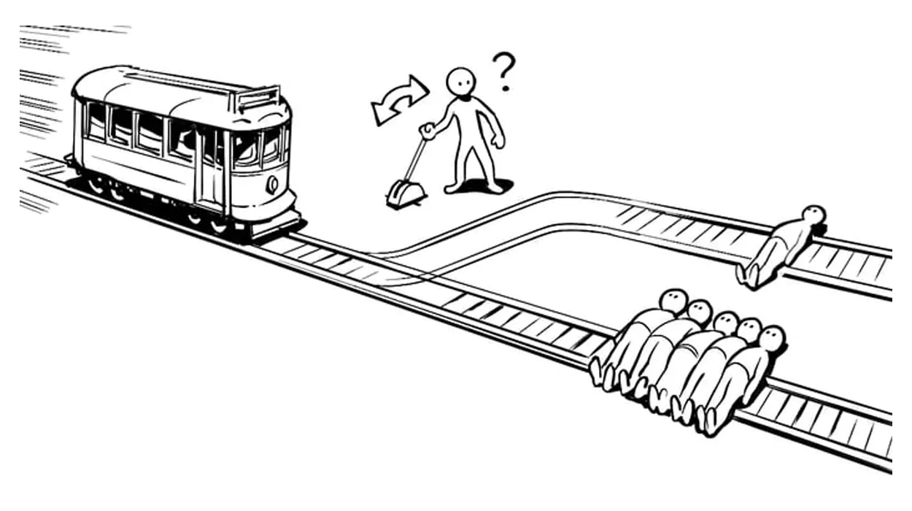

# Technology Trends and Societal Impacts

---
# Overview

- Technology and predictions about the future
- Fact vs fiction
- AI and ethical decision-making
- The trolley problem
- Virtue ethics, care ethics, and justice and fairness
- Technology's impact on society
- Why we must think critically about innovation
- Researching trends and connecting them to computer science
- Analyzing industry impacts and practical ethical safeguards

---
# Fact vs Fiction

Science fiction often imagines the future long before the technology exists.

Sometimes these predictions are surprisingly accurate.

Examples:

- Surveillance technologies
- Artificial intelligence
- Virtual reality
- Autonomous vehicles

The question is not whether predictions are perfect, but what they help us think about.

---
# George Orwell's *1984*

Published in 1949.

Key themes:

- Mass surveillance
- Loss of privacy
- Information control
- Government monitoring

At the time, these ideas seemed extreme.

Today, discussions about online tracking, data collection, and digital privacy have made these themes relevant again.

---
# Science Fiction and Technology

Many technologies first appeared in books and movies before becoming reality.

Examples:

- Video calls
- Voice assistants
- Smart devices
- Virtual reality
- Artificial intelligence

Science fiction often inspires engineers and entrepreneurs.

---
# iRobot (2004)


Questions explored:

- Should robots make decisions for humans?
- Can machines be trusted?
- How should AI handle ethical choices?

Many of these questions now apply to real AI systems.

---
# The Matrix (1999)

Themes include:

- Simulated realities
- Dependence on technology
- Artificial intelligence
- Human autonomy

While we do not live in a simulated world, technologies such as virtual reality and AI raise similar philosophical questions.

---
# Technology Creates New Ethical Questions

As technology becomes more powerful, difficult decisions emerge.

Examples:

- Self-driving cars
- Medical AI systems
- Facial recognition
- Military drones

Who is responsible when technology makes a mistake?

---
# The Trolley Problem



A classic thought experiment in ethics.

There is no universally accepted answer.

Yet similar questions can arise when designing real-world technologies.

---
# Why Do We Discuss This?

Imagine a self-driving vehicle.

A collision becomes unavoidable.

How should the software respond?

- Protect passengers?
- Protect pedestrians?
- Minimize total harm?

Someone has to make these decisions when designing the system.

---
# What Did AI Say About the Trolley Problem?

In the early days of generative AI, many people asked systems like ChatGPT to answer ethical questions.

Interestingly, AI systems do not possess beliefs or values.

Instead, they explain different viewpoints and ethical frameworks.

---
# A Brief Survey of Ethical Perspectives

This is a computer science course, not an ethics course.

- We are taking a very basic, introductory look at a few ethical perspectives
- Each perspective has much more depth and debate than we can cover here
- The goal is to give names and structure to thoughts you may already have
- Use these frameworks to explain your reasoning about technology and consider other viewpoints

Think of this as a starting point for discussion, not a complete account of ethics.

---
# Two Common Approaches to the Trolley Problem

Many discussions of the trolley problem focus on two major perspectives:

1. Utilitarianism
2. Deontological Ethics

Both approaches attempt to answer the same question using different reasoning.

---
# Utilitarianism

Focus:

```text
Greatest good for the greatest number
```

**Think about the trolley problem:** Which choice would reduce the total harm to everyone on the tracks?

<div class="fragment">

**How it might apply:**

- Diverting the trolley would save five people while causing one death
- In the standard scenario, this produces fewer deaths than doing nothing
- A utilitarian argument would typically favor diverting it on that basis

</div>

---
# Deontological Ethics

Focus:

```text
Some actions are morally wrong,
regardless of the outcome
```

**Think about the trolley problem:** What duties or rights should guide your choice, even if another choice saves more people?

<div class="fragment">

**How it might apply:**

- A duty not to harm could support refusing to divert the trolley toward the one person
- A duty to rescue could support intervening to protect the five
- The argument depends on how duties, rights, and the distinction between intended and foreseen harm are understood

</div>

---
# Other Ethical Perspectives

Outcomes and duties are not the only ways to reason about ethical decisions.

- **Virtue ethics:** Character and practical judgment
- **Care ethics:** Relationships, needs, and responsibilities
- **Justice and fairness:** Fair treatment and the distribution of benefits and harms

These perspectives can overlap and help us notice different aspects of the same situation.

---
# Virtue Ethics

Focus: What would a responsible, honest professional do?

- Consider character traits such as honesty, courage, and practical wisdom
- Ask what good professional judgment requires in this situation

**Think about the trolley problem:** How might a compassionate person with courage and practical wisdom respond?

<div class="fragment">

**How it might apply:**

- A person might divert the trolley out of compassion for those in danger, while recognizing the gravity of the one death
- The reasoning would examine motives and judgment, rather than treating the death count as the only consideration
- Virtue ethics does not prescribe one automatic answer about pulling the lever

</div>

---
# Care Ethics

Focus: How should we respond to people's needs, relationships, and vulnerability?

- Pay attention to the circumstances of the people affected
- Consider responsibilities created by dependence and relationships
- Listen to people whose needs may be overlooked

**Think about the trolley problem:** Whose needs, vulnerability, or relationships might the simplified scenario leave out?

<div class="fragment">

**How it might apply:**

- A care-focused response would attend to the people on both tracks and any responsibilities toward them
- It might question whether the forced choice hides possibilities for warning or helping people
- If the scenario rules out every other option, relationships and needs still matter to the reasoning; they do not mechanically settle the choice

</div>

---
# Justice and Fairness

Focus: Who receives the benefits, and who bears the risks?

- Examine access, treatment, and the distribution of opportunities
- Ask whether decision procedures are fair and can be challenged
- Consider whether a system disadvantages particular groups

**Think about the trolley problem:** Would the rule behind your choice treat each person fairly, including the person on the other track?

<div class="fragment">

**How it might apply:**

- Equal consideration could support saving five lives rather than one, without valuing anyone by status
- Another fairness argument could question imposing a fatal burden on someone who was initially safe
- Explain why your choice is fair, including to the people who would be harmed

</div>

---
# Five Perspectives on Automated Hiring

A company proposes using software to screen job applicants.

| Perspective | Question to ask |
| --- | --- |
| Utilitarianism | Do the overall benefits outweigh the harms to applicants and others? |
| Deontological ethics | Does screening respect applicants' rights and duties of honest treatment? |
| Virtue ethics | What would an honest, responsible hiring team do? |
| Care ethics | How will the process respond to applicants' individual needs and circumstances? |
| Justice and fairness | Are opportunities and errors distributed fairly, and can decisions be appealed? |

These perspectives can overlap or conflict.

---
# Ethics in Technology Design

Modern technologies sometimes force us to consider these perspectives.

Examples:

- Autonomous vehicles
- Medical decision systems
- Emergency response algorithms
- Military technologies

Technology is not value-neutral.

Human decisions are built into the systems we create.

---
# What Do YOU Think?

If you were designing an autonomous vehicle:

- Should it prioritize minimizing harm?
- Should it always protect its passengers?
- Should humans make these choices rather than software?

There are no easy answers.

---
# Someone Has to Program These Systems

Technology does not make ethical decisions on its own.

People design:

- The rules
- The priorities
- The algorithms
- The limitations

Understanding technology also means understanding the human choices behind it.

---
# Assignment: Technology Trends

Research a current trend in computing, software, or the internet, such as AI, cloud computing, robotics, or AR/VR.

- Explain what it does and its current state of development
- Connect it to computer science concepts and its impact on an industry
- Identify one or two ethical concerns and propose practical responses
- Use reliable sources and APA-style citations

Submit approximately **2 double-spaced pages** in **PDF or Word format**. Write in your own words and cite borrowed ideas.

The next slides will help you move from a broad topic to a supported analysis.

---

# Why Technology Trends Matter

Technology impacts nearly every industry.

Examples:

- Healthcare
- Business
- Education
- Manufacturing
- Entertainment

Understanding trends helps us prepare for future opportunities and challenges.

---
# The Importance of Publication Dates

When researching technology:

Always ask:

- When was this published?
- Is the information still accurate?
- What has changed since then?

Technology can change dramatically in just a few years.

---
# From a Broad Topic to a Focused Question

A broad label is a starting point, not an explanation.

- **AI:** How could a system help identify suspicious transactions?
- **Cloud computing:** How could an application handle changing demand?
- **Blockchain:** How could participants maintain a shared transaction record?
- **Robotics:** How could a robot navigate a warehouse safely?
- **AR/VR:** How could a simulation support job training?

Choose a specific use case, then investigate what evidence supports it.

---
# Explain the Technology Before Evaluating It

- **Purpose:** What problem does it try to solve, and for whom?
- **Operation:** What inputs, processing, and outputs are involved?
- **Development:** Is the example a research prototype, a pilot, or a deployed product?
- **Limits:** What conditions, costs, or errors restrict its usefulness?

Separate demonstrated capabilities from predictions and marketing claims.

---
# Finding and Evaluating Evidence

- Use technical documentation to understand how a system works
- Look for research that explains methods, results, and limitations
- Compare vendor claims with independent reporting or evaluations
- Check the author's expertise, publication date, and supporting evidence
- Ask whether a result from one setting applies to another

A search result or AI-generated answer can suggest leads. Read and verify the original sources before using their claims.

---
# Where Is the Computer Science?

Connect a technology's behavior to the mechanisms that enable it.

| Technology | Computer science connection |
| --- | --- |
| AI | Algorithms process data to train and evaluate models |
| Cloud computing | Networks and distributed systems coordinate remote resources |
| Blockchain | Cryptography and consensus protocols help verify shared records |
| Robotics | Algorithms combine sensor data, planning, and control |
| AR/VR | Computer graphics and tracking update a simulated scene |

Explain what the mechanism does; naming it alone is not enough.

---
# Connect New Technologies to Familiar Concepts

Consider a hypothetical warehouse robot:

- **Objects:** Represent the robot, locations, and delivery tasks
- **Data structures:** Store a map and a queue of tasks
- **Algorithms:** Choose a route around obstacles
- **Input/output:** Read sensors and send movement commands
- **Testing:** Check behavior when a sensor fails or a path is blocked

Ask: Which concepts explain the system's behavior, and which require further research?

---
# Analyze an Industry Impact

Trace a change through a specific workflow:

**Technology → task changed → people affected → benefit and tradeoff**

Hypothetical example: A warehouse introduces delivery robots.

- Robots could move goods between storage and packing stations
- Workers' tasks could shift toward supervision and maintenance
- Potential benefits include less repetitive lifting
- Tradeoffs include training costs, downtime, and safety risks

Evidence is needed to determine whether these outcomes occur in a real deployment.

---
# Turn an Ethical Concern into a Concrete Risk

Go beyond saying a technology has "privacy issues" or "bias."

- **Privacy:** What data is collected? Who can access it? Could it be reused?
- **Bias:** Who could experience more errors or fewer opportunities?
- **Employment:** Which tasks change, and who has access to retraining?
- **Accountability:** Who can investigate a mistake or challenge a decision?

Identify the affected people, the mechanism of harm, and the evidence needed to assess it.

---
# Match Safeguards to the Risk

| Risk | Possible response |
| --- | --- |
| Unnecessary personal data collection | Collect less data and set deletion deadlines |
| Unequal error rates | Evaluate performance across affected groups and investigate gaps |
| Harmful automated decisions | Provide human review and a way to appeal |
| Changing job requirements | Offer training and involve workers in deployment planning |

Responses can combine software changes, organizational policies, oversight, and education.

---
# Evaluate the Safeguard, Too

A proposed solution needs a plan for checking whether it works.

For a hypothetical automated screening system:

- **Risk:** Qualified applicants could be rejected incorrectly
- **Action:** Audit rejection errors and provide an appeal process
- **Owner:** The organization deploying the system
- **Check:** Track errors, review outcomes, and whether appeals are accessible
- **Limit:** Human reviewers also need training, time, and oversight

Ask what remains unresolved after the safeguard is introduced.

---
# Write Analysis, Not Just Description

**Description:** A robot uses sensors and route-planning software.

**Analysis:** Sensor errors could affect route choices and create collision risks. Testing blocked paths and sensor failures helps evaluate whether the robot can stop safely.

Build an explanation with:

- A specific claim
- Evidence from a source
- Your reasoning about what the evidence means
- A limitation or tradeoff

Clearly label hypothetical examples and distinguish them from documented results.

---
# Give Credit to Your Sources

Cite borrowed ideas and findings even when you explain them in your own words.

- Keep source details while taking notes
- Paraphrase the meaning rather than replacing a few words
- Use quotation marks for exact wording
- Connect each source-based claim to an in-text citation
- Include the matching full entry in a reference list

Your analysis should explain how the evidence supports your conclusions.

---
# APA Citation Basics

For a paraphrase, use an author and year: **(Author, Year)**.

A common webpage reference pattern is:

> Author, A. A. (Year, Month Day). *Title of webpage*. Site Name. URL

- An organization can be the author; omit the site name if it repeats that author
- Use **n.d.** when no publication date is available
- For direct quotations, add a page number or another locator, such as a paragraph number
- Match in-text citations to reference entries and alphabetize the reference list

See the [APA webpage reference guide](https://library.ulethbridge.ca/apa7style/online/webpages) for examples and exceptions.

---
# Practice: Investigate a Proposed Technology

A company proposes using VR to train warehouse employees.

- What would you need to learn about the system and its development stage?
- Which computer science concepts explain how it works?
- What evidence would show whether training transfers to the workplace?
- Who might benefit, and who might face accessibility barriers?
- What safeguard would you propose, and how would you evaluate it?

Separate what you know, what you infer, and what you still need to research.

---
# Predictions vs Reality

Past predictions included:

- Smart cities
- Autonomous transportation
- Connected devices
- Online retail growth
- Artificial intelligence

Some predictions happened quickly.

Others evolved more slowly than expected.

---
# Technology Is About People

Technology is not just about devices and software.

It affects:

- Privacy
- Jobs
- Communication
- Education
- Safety
- Human behavior

The social impact is often as important as the technology itself.

---
# Summary

- Technology trends shape society
- Science fiction often explores future challenges
- AI and autonomous systems raise questions about responsibility and harm
- Utilitarianism emphasizes outcomes; deontological ethics emphasizes duties and rules
- Virtue ethics considers character; care ethics considers relationships and needs
- Justice and fairness examine opportunities, procedures, and who bears risks
- People build priorities and limitations into technology
- Evaluate technology claims critically, including publication dates and social impacts

---
# Summary: Investigating a Technology Trend

- Focus on a specific use case and explain its purpose, operation, and limits
- Verify its development stage using reliable, dated evidence
- Connect its behavior to computer science concepts
- Trace industry impacts to tasks, people, benefits, and tradeoffs
- Propose safeguards for specific harms and explain how to evaluate them
- Support your analysis with citations and a matching reference list
