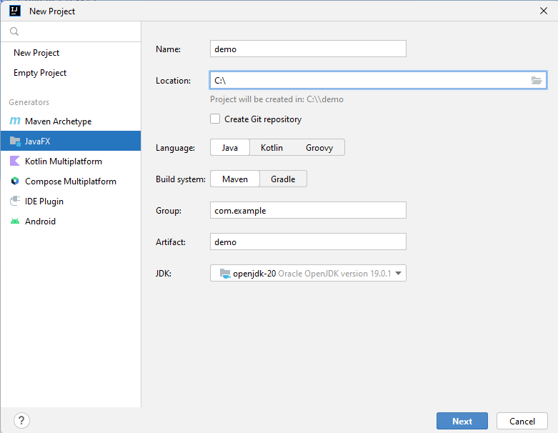
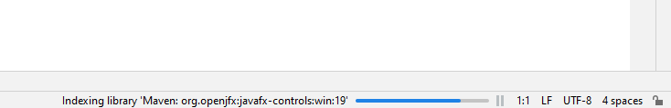
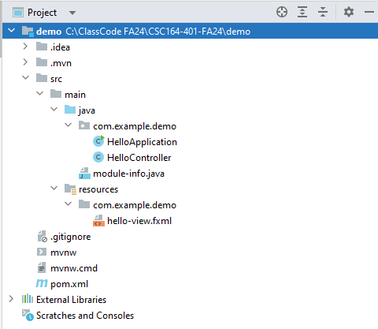
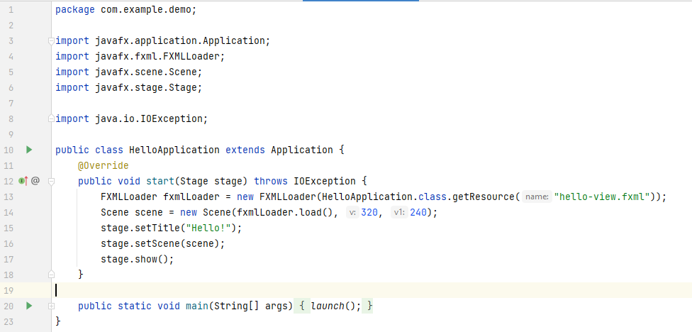
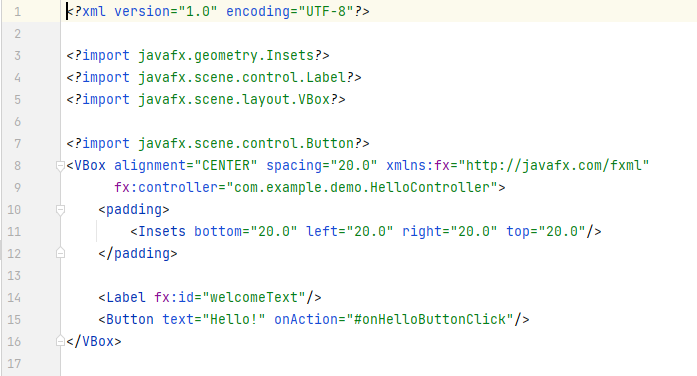
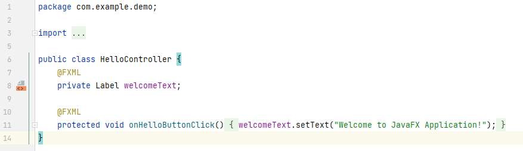
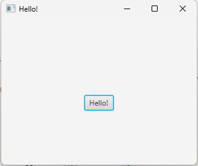
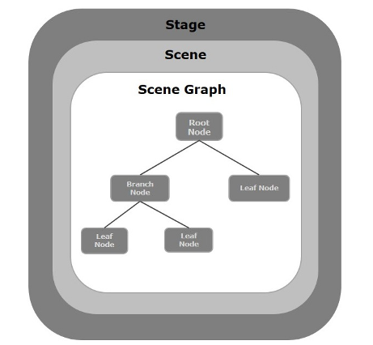

# JavaFX Basics

---

# Overview

- Connect JavaFX components to classes, objects, inheritance, and polymorphism
- Explore a JavaFX project and its generated files
- Distinguish the model, view, and controller
- Build an interface using a stage, scene, and layout container
- Trace application startup and a complete Java-only example

---

# JavaFX Introduction
- JavaFX is a GUI (graphical user interface) library.
- It is a collection of classes used to build graphical programs.
- IntelliJ can automatically configure JavaFX projects.

---

# OOP at work
- **Classes**: JavaFX components such as `Text`, `Pane`, `Button`, and `Scene` are classes.
- **Objects**: Every piece of the interface is an object.
- **Inheritance**: Most visual components inherit from `Node`.
- **Polymorphism**: `getChildren().add()` can add different subclasses of `Node`.

```java
Text text = new Text("Hello World");
```

---

# Inheritance
- Many classes share common features.
- JavaFX classes inherit from Node, Parent, etc.
- Shared functionality is inherited.

---

# Why It Matters
- OOP is how real applications are structured.
- Helps build modular, maintainable code.
- Essential for JavaFX, Android, and Java Collections.

---

# Follow the Project Files

| File | Responsibility |
| --- | --- |
| Application class | Starts the app and attaches content to a window |
| FXML file | Describes UI objects and their properties |
| Controller class | Initializes the view and responds to interaction |
| Build configuration | Declares dependencies and build settings |

Generated names vary. Find each file's role instead of memorizing its name.

---

# How Does the Window Open?

1. The JavaFX runtime creates the application object
2. It calls `start(Stage primaryStage)`
3. Your code creates or loads the UI and attaches a scene
4. `show()` displays the window
5. The application waits for events such as user input

`start()` is different from a controller's `initialize()` method.

<!-- footer -->
https://openjfx.io/javadoc/25/javafx.graphics/javafx/application/Application.html

---

# Creating a new project


---

# Be patient…


---

# Project structure details


---

# The code… but not really


---

# FXML


---

# FXML
- FXML is a language used to describe the View (UI).
- UI components can also be created directly in Java.

```java
Text text = new Text();
text.setText("Hello World");
```

---

# Controller


---

# FXML, Controllers
- Controllers provide the logic behind GUIs represented in FXML.
- Multiple GUI instances can each have their own data and behavior.

---

# MVC (Model View Controller) Architecture
- Model
- View
- Controller

---

# Model
- Manages data, logic, and rules.
- Think of it as: "What the app does."

---

# Model in JavaFX
- A model can be an ordinary Java object holding application data and rules.
- A database is optional; data can live in memory or files.
- Keep business rules separate from code that arranges or updates controls.

---

# View
- Responsible for what the user sees and interacts with.
- Think of it as: "What the app looks like."

---

# View in JavaFX
- UI can be created using Java or FXML.
- CSS can also be used.

---

# Controller
- Handles user input.
- Interacts with the model.
- Updates the view.

---

# Controller in JavaFX
- Just another class.

---

# MVC Example: A Course Grade Tool

- **Model:** Stores scores and calculates the average
- **View:** Displays score inputs and the result
- **Controller:** Reads inputs, asks the model to calculate, and updates the result

Changing the window layout should not require rewriting the average calculation.

---

# Why?
- Organized codebase
- Separation of concerns
- Reusability
- Team collaboration

---

# The program


---

# Stage, Scene, and Layout Containers


<!-- footer -->
https://www.tutorialspoint.com/javafx/javafx_application.htm

---

# Stage
A stage is a top-level window. Its scene holds the UI content displayed in that window.

<!-- footer -->
https://www.tutorialspoint.com/javafx/javafx_application.htm

---

# Scene
A scene holds a tree of UI nodes, starting with a root node such as a layout container.

<!-- footer -->
https://www.tutorialspoint.com/javafx/javafx_application.htm

---

# Layout Containers
- HBox
- VBox
- BorderPane
- StackPane
- TextFlow
- AnchorPane
- TilePane
- GridPane
- FlowPane

<!-- footer -->
https://www.tutorialspoint.com/javafx/javafx_layout_panes.htm

---

# So, finally…

```java
primaryStage.setTitle("My First JavaFX App");
Text text = new Text();
text.setText("Hello World");
Pane pane = new Pane();
pane.getChildren().add(text);
Scene scene = new Scene(pane, 400, 200);
primaryStage.setScene(scene);
primaryStage.show();
```

<!-- footer -->
https://www.javaguides.net/2019/07/javafx-hello-world-example-tutorial.html

---

# A Complete Java-Only Example

In a configured JavaFX project, create `HelloApp.java`:

```java
import javafx.application.Application;
import javafx.scene.Scene;
import javafx.scene.layout.StackPane;
import javafx.scene.text.Text;
import javafx.stage.Stage;

public class HelloApp extends Application {
    @Override
    public void start(Stage stage) {
        Text message = new Text("Hello World");
        StackPane root = new StackPane(message);
        stage.setScene(new Scene(root, 400, 200));
        stage.setTitle("My First JavaFX App");
        stage.show();
    }

    public static void main(String[] args) {
        launch(args);
    }
}
```

If the project uses packages, add its package declaration first.

---

# Read the Object Structure

For the example, trace the containment:

```text
Stage -> Scene -> StackPane -> Text
```

- `Stage` and `Scene` are not subclasses of `Node`
- The `StackPane` and `Text` belong to the scene graph
- The layout container manages where its child appears

---

# OOP
- JavaFX is Object-Oriented Programming applied to user interfaces.
- Text, Pane, Scene, and Stage are objects.

---

# OOP Components
- Text, Pane, and Scene are classes.
- Objects expose methods like `setText()` and `getChildren().add()`.
- Objects can contain other objects.
- `primaryStage` is provided by the framework.

---

# Summary

- JavaFX interfaces are built from interacting objects
- FXML describes the view; controller classes provide behavior
- MVC separates data and rules, presentation, and user interaction
- A stage contains a scene, and layout containers organize its nodes
- Java code can create and configure UI components directly
