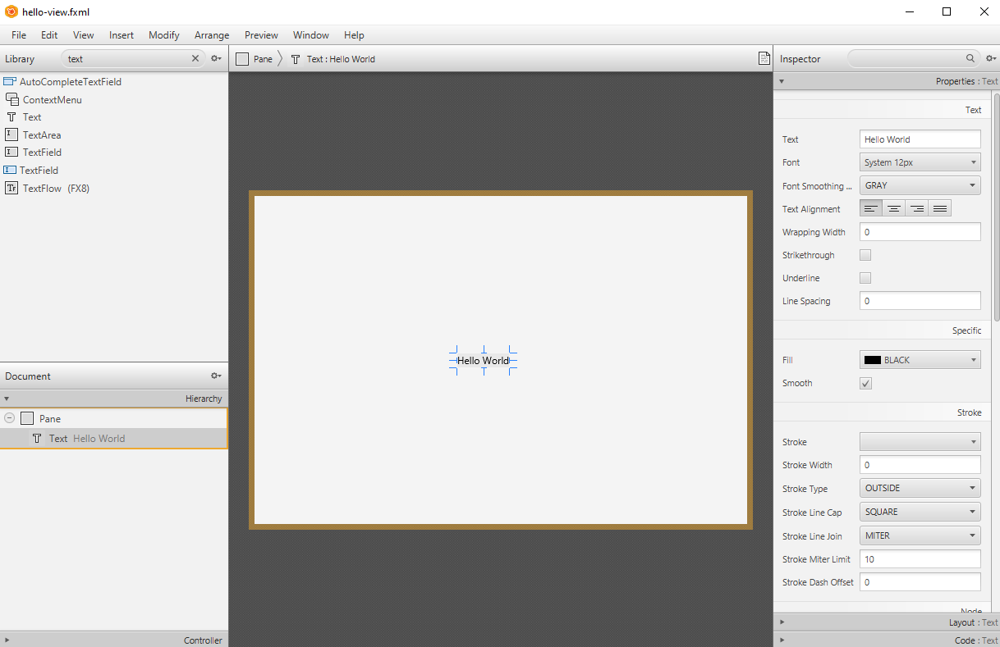
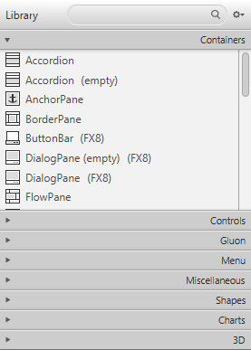
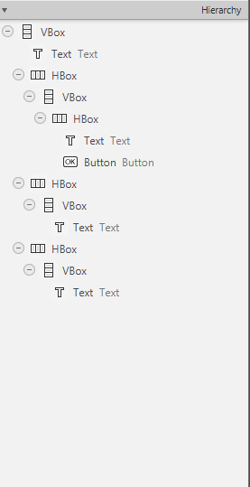
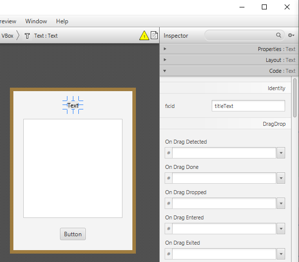
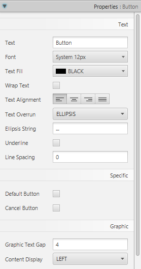
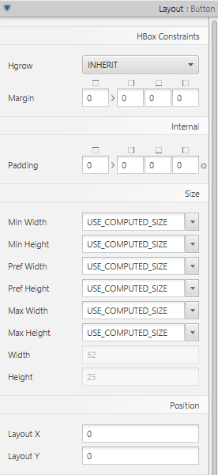
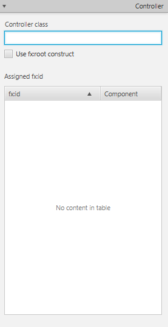
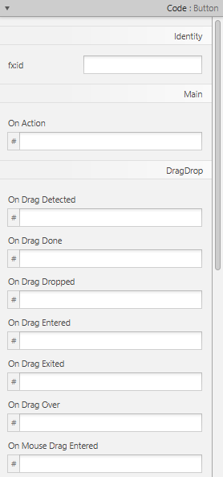
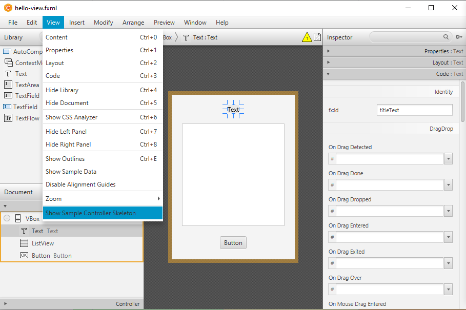
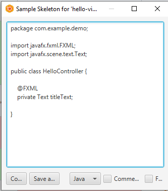

# Building JavaFX Interfaces with SceneBuilder

---

# Overview

- Use SceneBuilder to create FXML visually
- Explore the Library, Hierarchy, and Inspector panels
- Configure layout, controller settings, and component identifiers
- Generate a controller skeleton and initialize FXML components
- Connect, load, and troubleshoot an FXML view

---

# Setting up the IDE
- Use IntelliJ together with SceneBuilder.

<!-- footer -->
https://gluonhq.com/products/scene-builder/

---

# A simpler way to write FXML
- Drag and drop
- A GUI for building GUIs



---

# In the end… it’s all just code (and classes/objects)

```xml
<?xml version="1.0" encoding="UTF-8"?>
<?import javafx.scene.layout.Pane?>
<?import javafx.scene.text.Text?>
<Pane>
  <children>
     <Text text="Hello World" />
  </children>
</Pane>
```

---

# Library

Choose a control or container, then drag it into the view.


---

# Hierarchy

Inspect which container owns each child.


---

# Nesting Objects

Moving an object into a different container changes its parent and can change its layout.


---

# Inspector

Select an object first; its class determines the available settings.


---

# Layout

Adjust spacing, padding, and sizing. Resize the preview to check the result.


---

# Controller

Set the fully qualified controller class name, including its package.


---

# Code

Set identifiers and event handler names to connect the view to Java code.


---

# fx:id
- GUI components need an `fx:id` to be accessed from the Controller.
- A matching controller field receives a reference to the loaded component.
- Names and types must match; the CSS `id` setting serves a different purpose.


---

# Sample Controller Skeleton (1)
- Access via View → Show Sample Controller Skeleton.



---

# Sample Controller Skeleton (2)
- Copy the needed declarations into your existing controller.
- Keep your package declaration, imports, and existing logic.



---

# Where do I put the code?
- Procedural programming starts from `main`.
- Event-driven programming uses event handlers.
- Initialization code still needs a starting location.

---

# Connect FXML to a Controller

Example `hello-view.fxml`:

```xml
<?xml version="1.0" encoding="UTF-8"?>
<?import javafx.scene.layout.StackPane?>
<?import javafx.scene.text.Text?>
<StackPane xmlns:fx="http://javafx.com/fxml/1"
           fx:controller="com.example.demo.HelloController">
    <children>
        <Text fx:id="titleText" text="Loading..." />
    </children>
</StackPane>
```

The controller class and field names must match the Java code.

---

# The Matching Controller

```java
package com.example.demo;

import javafx.fxml.FXML;
import javafx.scene.text.Text;

public class HelloController {
    @FXML
    private Text titleText;

    @FXML
    private void initialize() {
        titleText.setText("Welcome to JavaFX!");
    }
}
```

Change the injected object. Creating a separate new Text does not update the object on screen.

---

# Load the View

In the application class in `com.example.demo`, inside `start()`:

```java
FXMLLoader loader = new FXMLLoader(
    getClass().getResource("hello-view.fxml")
);
Scene scene = new Scene(loader.load(), 400, 200);
primaryStage.setScene(scene);
primaryStage.show();
```

- Import `javafx.fxml.FXMLLoader`, `javafx.scene.Scene`, and `java.io.IOException`
- Add `throws IOException` to the `start()` declaration
- Place FXML in the matching resources package
- For a modular project, include `opens com.example.demo to javafx.fxml;`

<!-- footer -->
https://openjfx.io/javadoc/25/javafx.fxml/javafx/fxml/doc-files/introduction_to_fxml.html

---

# Initialize vs Constructor
- Constructors cannot directly access FXML-created objects.
- `initialize()` is called after the FXML file loads.

---

# Initialize method

```java
@FXML
void initialize() {
    titleText.setText("Hello World!");
}
```

---

# Try it yourself! Experiment…
- Download and install SceneBuilder.
- Create a JavaFX project.
- Configure SceneBuilder in IntelliJ.
- Explore UI components.

---

# Debug the Connection

| Symptom | Check first |
| --- | --- |
| FXML resource not found | Filename, case, and resources package |
| Controller cannot load | Class and package in fx:controller |
| Controller field is null | fx:id, field type, @FXML, and loading order |
| Module access error | Controller package opens to javafx.fxml |

Read the exception details and underlying cause before changing code.

---

# Practice: Find the Mismatch

FXML uses `fx:id="titleText"`, but the controller declares:

```java
@FXML
private Text headingText;
```

---

# Summary

- SceneBuilder provides a visual way to create FXML
- The Library supplies components; the Hierarchy shows their nesting
- The Inspector configures component properties, layout, and code settings
- An fx:id connects a component to a controller field
- A controller skeleton provides declarations to copy into the controller
- Use initialize() after FXML loading to configure injected components
