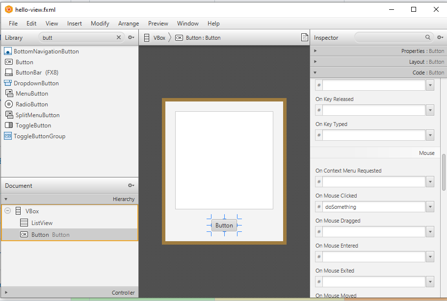
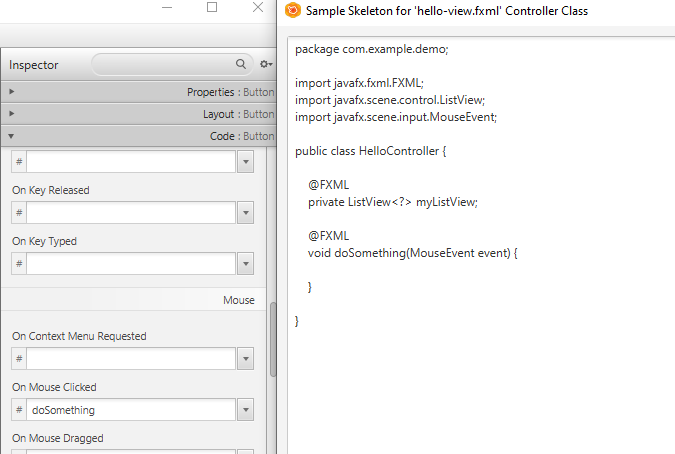

# Event Driven Programming

---

# Overview

- Compare procedural, object-oriented, and event-driven program flow
- Identify events and event handler methods
- Connect a JavaFX event to a controller method

---

# Procedural Programming
- A procedural program describes how to do something step by step.
- Everything is laid out from start to finish.
- Execution typically starts at `main` and proceeds sequentially.

<!-- footer -->
https://www.reddit.com/r/explainlikeimfive/comments/1mjkis/eli5_the_difference_between_procedural_event/

---

# Object Oriented Programming
- OOP starts by identifying objects and the messages those objects should respond to.
- Programs become collections of interacting objects.

<!-- footer -->
https://medium.com/@zedrick.ara/what-is-oop-eli-5-286a7292e2f9

---

# Event Driven Programming
- Event-driven programs have no clear start or end.
- Program flow is controlled by external events.

<!-- footer -->
https://www.reddit.com/r/explainlikeimfive/comments/1mjkis/eli5_the_difference_between_procedural_event/

---

# Events
- Mouse clicks
- Hover events
- Drag events
- Text entered/changed
- Various UI interactions trigger events.
- Event objects can be passed into event handlers.

---

# Event Handlers
- Methods called when events occur.
- Usually receive an event object.

---

# Binding Event Handler in JavaFX
- Select the object.
- Go to the Code section.
- Find the event.
- Enter the handler method name.

---

# Binding Event Handler in JavaFX
- Don't forget to grab the corresponding Controller code.

---

# Summary

- Events guide the flow of an interactive program
- Event handlers run in response to user interactions
- SceneBuilder connects events to named controller methods
- Generated controller code provides a starting point for handlers
