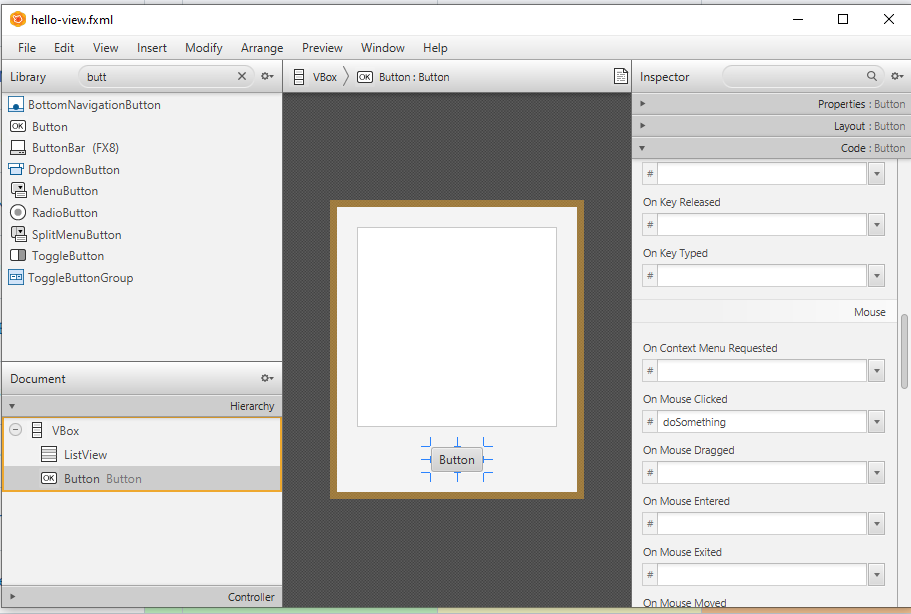
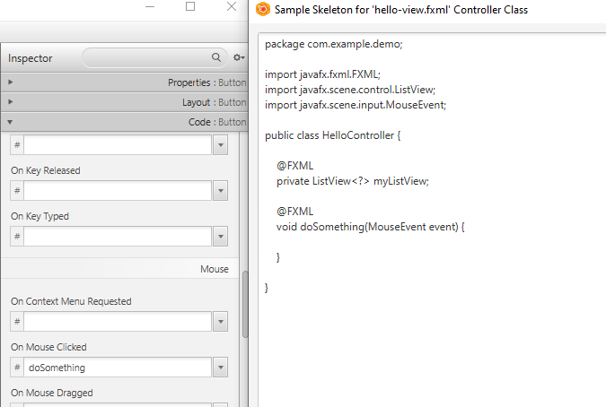

# Event Driven Programming

---

# Overview

- Compare procedural, object-oriented, and event-driven program flow
- Identify events and event handler methods
- Connect a JavaFX event to a controller method

---

# Procedural Programming
- A procedural program describes how to do something step by step.
- Everything is laid out from start to finish.
- Execution typically starts at `main` and proceeds sequentially.

```java
public static void main(String[] args) {
    Scanner in = new Scanner(System.in);
    System.out.print("Enter a number: ");
    int n = in.nextInt();          // program waits HERE
    System.out.println(n * 2);
}                                  // program ends
```

- The program decides when to ask for input and when to finish.

<!-- footer -->
https://www.reddit.com/r/explainlikeimfive/comments/1mjkis/eli5_the_difference_between_procedural_event/

---

# Object Oriented Programming
- OOP starts by identifying objects and the messages those objects should respond to.
- Programs become collections of interacting objects.

```java
BankAccount acct = new BankAccount("Ana");
acct.deposit(50.0);                // send a message to an object
System.out.println(acct.getBalance());
```

<!-- footer -->
https://medium.com/@zedrick.ara/what-is-oop-eli-5-286a7292e2f9

---

# Event Driven Programming
- Event-driven programs have no clear start or end.
- Program flow is controlled by external events.
- The application sits idle until the user does something (like a click) that wakes it up.

<!-- footer -->
https://www.reddit.com/r/explainlikeimfive/comments/1mjkis/eli5_the_difference_between_procedural_event/

---

# Console vs. Event-Driven

| Console (Procedural) | JavaFX (Event-Driven) |
|----------------------|-----------------------|
| `Scanner` loop waits for input | Window waits for events |
| Your code decides what runs next | The user decides what runs next |
| Ends when `main` finishes | Runs until the window closes |

---

# Events
- Mouse clicks
- Hover events
- Drag events
- Text entered/changed
- Various UI interactions trigger events.
- Event objects can be passed into event handlers.

---

# Events: Small Examples

| User does... | Event | Typical use |
|--------------|-------|-------------|
| Clicks a Button | `ActionEvent` | Submit a form, add an item |
| Types in a TextField | `KeyEvent` | Live search, validation |
| Moves mouse over a node | `MouseEvent` (entered) | Highlight, tooltip |
| Drags a shape | `MouseEvent` (dragged) | Move an object |

---

# Event Handlers
- Methods called when events occur.
- Usually receive an event object.

```java
@FXML
private void onHelloClick() {
    System.out.println("Button was clicked!");
}
```

---

# Event Handler With an Event Object

```java
@FXML
private void onShapeClick(MouseEvent event) {
    System.out.println("Clicked at " + event.getX() + ", " + event.getY());
}
```

- The event object describes what happened (where, which key, etc.).
- Handlers without an event parameter are fine when you don't need the details.

---

# Mini Example: Click Counter

```java
public class CounterController {
    @FXML private Label countLabel;
    private int count = 0;          // data lives in a field

    @FXML
    private void onCountClick() {
        count++;
        countLabel.setText("Clicks: " + count);
    }
}
```

- No loop, no `main` logic: the handler runs only when the button is clicked.
- State that must persist between events belongs in fields, not local variables.

---

# Mini Example: Reading a TextField

```java
@FXML private TextField nameField;
@FXML private Label greetingLabel;

@FXML
private void onGreetClick() {
    String name = nameField.getText();
    greetingLabel.setText("Hello, " + name + "!");
}
```

- Read input inside the handler, when the event occurs.

---

# Binding Event Handler in JavaFX
- Select the object.
- Go to the Code section.
- Find the event.
- Enter the handler method name.



---

# Binding Event Handler in JavaFX
- Don't forget to grab the corresponding Controller code.



---

# Common Binding Mistakes

- Handler name in Scene Builder doesn't match the controller method (typos, case).
- Method isn't annotated with `@FXML` (when private).
- `fx:id` in Scene Builder doesn't match the controller field name, so the field is `null`.
- Controller class isn't set in Scene Builder's Controller section.

---

# Summary

- Events guide the flow of an interactive program
- Event handlers run in response to user interactions
- SceneBuilder connects events to named controller methods
- Generated controller code provides a starting point for handlers
