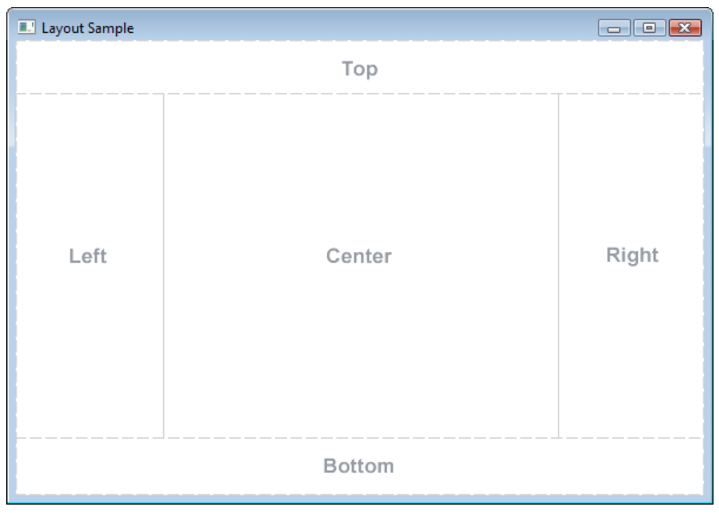
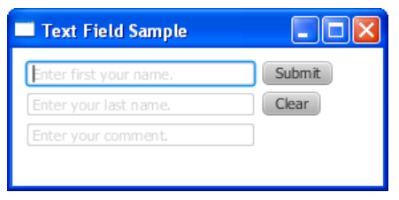
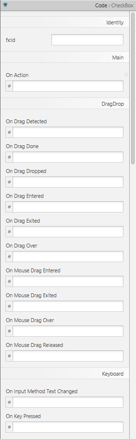

# JavaFX Layouts and User Input

---

# Overview

- Organize an interface with BorderPane, HBox, and VBox
- Choose controls for different kinds of user input
- Read control values in event handlers
- Explore events, shapes, and positioning

---

# Fun with JavaFX

---

# Experiment, Explore

Now that we have the basics down, we can experiment!

---

# BorderPane
- Usually a good starting point for applications.

<!-- footer -->
https://docs.oracle.com/javase/8/javafx/api/javafx/scene/layout/BorderPane.html

---

# BorderPane with HBox and VBox
- Top/bottom often use HBox.
- Left/right often use VBox.
- Regions can be left empty.

---

# User Input

---

# Buttons
- Buttons are user input and interaction.
- Many additional input controls exist.

---

# Other Inputs/Interactions
- Radio button
- Checkbox
- Sliders
- Much more

---

# Using Getters
- Use getters to determine selected values, checked state, and slider position.

---

# Text Input?
- Text and Label are display elements.
- Use TextField for input.
- Assign an `fx:id`.
- Use `getText()`.

---

# “When” to Read Those Values?
- Typically read values when an event occurs.
- Event handlers process user input.

---

# Typical Form

<!-- footer -->
https://docs.oracle.com/javafx/2/ui_controls/text-field.htm

---

# Other Possible Events
- Many possibilities exist.
- Behavior may not always be what you expect.
- Event processing is extensive.

<!-- footer -->
https://docs.oracle.com/javafx/2/events/processing.htm

---

# Shapes

- Rectangles
- Circles
- Other shapes

---

# Make Them Move Around
- Use setters.
- Layout containers affect positioning.
- Use AnchorPane as a simple solution.

---

# Summary

- Layout containers organize controls and influence their positions
- TextField provides text input; getters retrieve control values
- Event handlers determine when input is read and processed
- Controls support many events beyond button clicks
- Shapes are objects whose properties can be changed with setters
