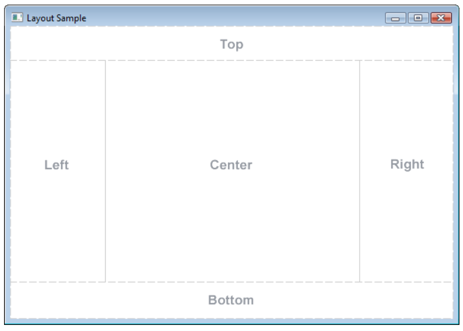

# JavaFX Layouts and Visual Design

---

# Overview

- Organize an interface with BorderPane, HBox, and VBox
- Nest layout containers to build complex interfaces
- Create shapes and reposition them with setters and AnchorPane
- Apply visual design principles: alignment, spacing, color, and sizing

---

# BorderPane
- Usually a good starting point for applications.
- Divides the window into five regions: top, bottom, left, right, center.



<!-- footer -->
https://docs.oracle.com/javase/8/javafx/api/javafx/scene/layout/BorderPane.html

---

# BorderPane Architecture

| Region | Purpose | Common Use |
|--------|---------|------------|
| **Top** | Menu bar, toolbar, title area | Navigation |
| **Bottom** | Status bar, controls | Footer/Actions |
| **Left** | Sidebar, navigation | Quick access |
| **Right** | Additional panels, filters | Secondary info |
| **Center** | Main content | Primary display |

---

# Combining Layouts: BorderPane + HBox/VBox

- **Top/Bottom** often use `HBox` (horizontal, left-to-right)
- **Left/Right** often use `VBox` (vertical, top-to-bottom)
- **Center** can be any layout or a single control
- **Any region can be left empty**

---

# HBox: Horizontal Layout

```
┌─────────────────────────────────┐
│ [Item1] [Item2] [Item3]         │
└─────────────────────────────────┘
```

- Items flow left to right
- Useful for toolbars, button rows, input rows
- Control spacing with `setSpacing()`, `setPadding()`

---

# VBox: Vertical Layout

```
┌──────────────┐
│   [Item1]    │
├──────────────┤
│   [Item2]    │
├──────────────┤
│   [Item3]    │
└──────────────┘
```

- Items flow top to bottom
- Useful for sidebars, form fields, menus
- Control spacing with `setSpacing()`, `setPadding()`

---

# Nesting Layouts: The Recipe

To build complex interfaces, nest layout managers:

```
BorderPane (main)
├─ Top: HBox (toolbar)
│  ├─ Label
│  ├─ TextField
│  └─ Button
├─ Left: VBox (sidebar)
│  ├─ Label
│  ├─ Button
│  └─ Button
├─ Center: ListView (content)
└─ Bottom: HBox (status)
   └─ Label
```

---

# Shapes

---

# Basic Shapes in JavaFX

- **Rectangle** – rectangles and squares
- **Circle** – circular shapes
- **Ellipse** – oval shapes
- **Polygon** – custom multi-sided shapes
- **Line** – straight lines
- **Path** – complex curves and paths

---

# Creating a Rectangle

```java
Rectangle rect = new Rectangle(x, y, width, height);
rect.setFill(Color.BLUE);
rect.setStroke(Color.BLACK);
rect.setStrokeWidth(2);
```

---

# Creating a Circle

```java
Circle circle = new Circle(centerX, centerY, radius);
circle.setFill(Color.RED);
circle.setStroke(Color.BLACK);
```

---

# Animating Shapes: Position Changes

Shapes can be repositioned using setters:

```java
Rectangle rect = new Rectangle(50, 50, 100, 100);

// Move the rectangle
rect.setX(200);
rect.setY(300);

// Change size
rect.setWidth(150);
rect.setHeight(75);

// Change appearance
rect.setFill(Color.GREEN);
rect.setOpacity(0.5);
```

---

# Layout Containers Affect Shape Positioning

**Important:** When shapes are added to layout containers:
- `BorderPane`, `HBox`, `VBox` position and resize them automatically
- Individual X/Y coordinates may be ignored
- For precise positioning, use `AnchorPane` or `Canvas`

---

# AnchorPane: Precise Positioning

Use `AnchorPane` when you need exact, independent control:

```java
AnchorPane pane = new AnchorPane();

Rectangle rect = new Rectangle(100, 100);
AnchorPane.setTopAnchor(rect, 50.0);      // 50px from top
AnchorPane.setLeftAnchor(rect, 50.0);     // 50px from left

pane.getChildren().add(rect);
```

---

# Visual Design Principles

---

# Alignment & Spacing

- Use consistent margins and padding
- Align related controls
- Group related elements together

```java
VBox form = new VBox();
form.setSpacing(10);           // 10px between items
form.setPadding(new Insets(15, 20, 15, 20));  // Margins
```

---

# Color Consistency

- Choose a primary color palette
- Use contrasting colors for emphasis
- Maintain consistency across the interface

```java
Color primary = Color.web("#2E86AB");
Color accent = Color.web("#A23B72");

button.setStyle("-fx-base: " + primary + ";");
```

---

# Sizing Strategies

- Use `setPrefWidth()` / `setPrefHeight()` for preferred sizes
- Use `setMinWidth()` / `setMaxWidth()` for constraints
- Allow containers to resize responsively

```java
listView.setPrefWidth(300);
textField.setMaxWidth(Double.MAX_VALUE);  // Grow with parent
```

---

# Summary

- **Layout containers** (BorderPane, HBox, VBox) organize controls and influence positioning
- **Nesting layouts** creates complex, organized interfaces
- **Shapes** are objects with properties that can be changed (color, position, size)
- **AnchorPane** provides precise control when exact positioning is needed
- **Visual design principles** (alignment, spacing, color, sizing) create professional interfaces

---

<!-- references -->
- https://docs.oracle.com/javase/8/javafx/api/javafx/scene/layout/BorderPane.html
- https://docs.oracle.com/javase/8/javafx/api/javafx/scene/layout/HBox.html
- https://docs.oracle.com/javase/8/javafx/api/javafx/scene/layout/VBox.html
- https://docs.oracle.com/javase/8/javafx/api/javafx/scene/shape/Rectangle.html
- https://docs.oracle.com/javase/8/javafx/api/javafx/scene/shape/Circle.html
