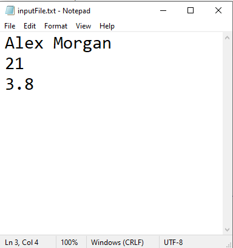
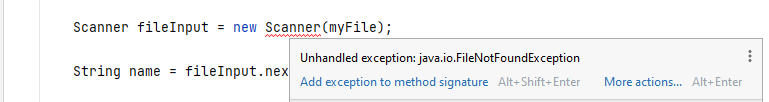
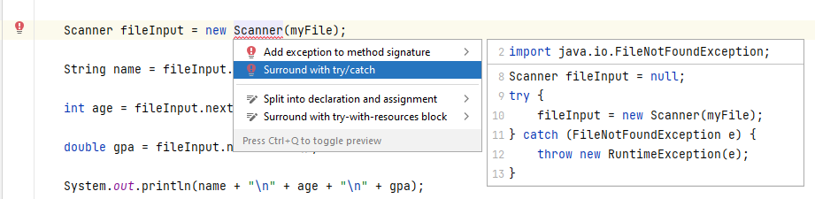
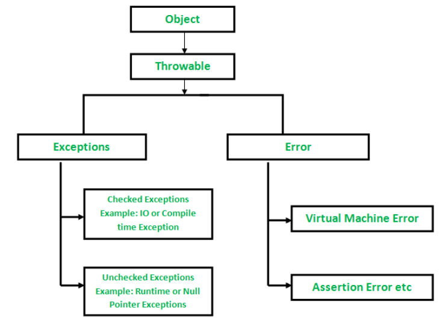
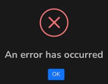

# File Input and Exceptions

---

# Overview

- Use Scanner to read data from a file
- Distinguish relative and absolute file paths
- Recognize checked and unchecked exceptions
- Handle failures with throws or try-catch

---

# This is ALL OOP
- Without understanding OOP, all we can hope for is to memorize/google things every time.

---

# Scanner class
- `Scanner input = new Scanner(System.in);`
- Scanner → class
- input → reference variable
- Scanner() → constructor
- System.in → argument for overloaded constructor
- Standard input
- Instance methods:
  - `nextInt()`
  - `next()`
  - `nextLine()`
  - `nextBoolean()`
  - `nextFloat()`
  - `nextDouble()`
  - `next().charAt(0)`

<!-- footer -->
https://docs.oracle.com/javase/8/docs/api/java/lang/System.html

---

# Different constructor

```java
Scanner fileInput = new Scanner(new File("myfile.txt"));

File myFile = new File("myfile.txt");
Scanner fileInput = new Scanner(myFile);
```

```java
import java.io.File;
import java.util.Scanner;
```

---

# Understanding Relative vs Absolute Paths

## Absolute Path
```java
File file = new File("C:\\Users\\John\\Documents\\data.txt");
Scanner sc = new Scanner(file);
```

## Relative Path
```java
File file = new File("resources/data.txt");
Scanner sc = new Scanner(file);
```

---

# Absolute vs Relative Path

| Feature | Absolute Path | Relative Path |
|---|---|---|
| Portability | ❌ Hard to move across systems | ✅ Works across environments |
| Readability | ❌ Long and cluttered | ✅ Clean and concise |
| Usage Example | Requires full OS-based path | Relative to project folder |

---

# Best Practice

Use relative paths in projects to avoid hardcoding system-specific locations.

Java IDEs like IntelliJ usually treat the root folder as the working directory.

---

# Example Using Scanner

```java
File myFile = new File("sample.txt");
Scanner fileInput = new Scanner(myFile);
String name = fileInput.nextLine();
int age = fileInput.nextInt();
double gpa = fileInput.nextDouble();
System.out.println(name + "\n" + age + "\n" + gpa);
```



---

# That won't work, though…



---

# The fix



---

# Exceptions

---

# What is an exception?

An exception is an event that occurs during the execution of a program that disrupts the normal flow of instructions.

---

# We've already seen exceptions

```java
int ar[] = {1,2,3,4,5};
for (int i = 0; i <= ar.length; i++)
    System.out.println(ar[i]);
```

---

# Checked vs Unchecked Exceptions



---

# Checked exceptions

- Use `throws`
- Or use a `try-catch` block

---

# Option 1

```java
public static void main(String[] args) throws IOException
```

- Whoever calls this method must handle the exception.

---

# Option 2

```java
try {
    Scanner fileInput = new Scanner(myFile);
} catch (FileNotFoundException e) {
    // do something
}
```

---

# Try and catch

- `try` defines code to test for errors.
- `catch` defines code to execute if an error occurs.

---

# In practice

- The catch block should allow the program to continue safely or exit gracefully.

---

# Multiple Catch Blocks

```java
try {
    // risky code
} catch (IOException e) {
    // handles IOException
} catch (ArithmeticException e) {
    // handles ArithmeticException
} catch (Exception e) {
    // handles any other exceptions
}
```

---

# Throwable superclass

- The `Throwable` class is the superclass of all errors and exceptions in Java.

<!-- footer -->
https://docs.oracle.com/javase/8/docs/api/java/lang/Throwable.html

---

# Best Practice

- Place the most general exception (`Exception`) at the end.
- General catches can hide useful information.



---

# Other Exceptions

- NumberFormatException
- InputMismatchException
- Many more

<!-- footer -->
https://www.w3schools.com/java/java_try_catch.asp

---

# Summary

- Scanner can read a File through an overloaded constructor
- Relative paths are resolved from the working directory
- Checked exceptions must be caught or declared
- Try-catch blocks provide a place to respond to failures
- Place specific catch clauses before more general ones
