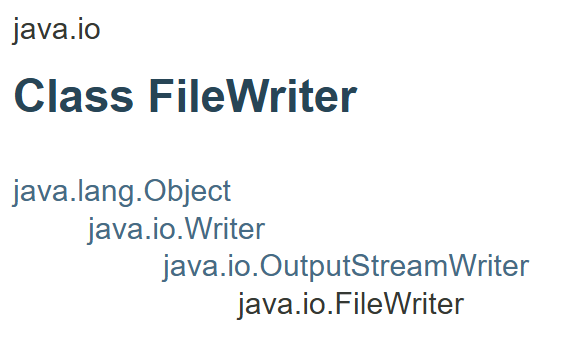

# Writing Text Files

---

# Overview

- Create, replace, and append to text files.
- Use FileWriter, BufferedWriter, and try-with-resources.
- Convert objects into CSV rows and save a collection in one pass.
- Follow a JavaFX roster from CSV import through editing and saving.

---

# From Java Data to a Text File

- A writer takes characters and sends them to a destination, such as a file.
- Saving a collection means choosing a text format and writing each record in that format.
- A relative path such as `students.csv` points to a file in the program's working directory. In an IDE, check the run configuration for that directory.
- Java can create the file when it opens a writer. Create any missing parent folders before opening the file.

---

# File and FileWriter

- A `File` represents a pathname. Constructing one gives Java a path to work with.
- `createNewFile()` creates an empty file and returns `false` if one already exists. Use it when you specifically need to create an empty file.
- Opening a `FileWriter` can create the file and prepare it for writing in one step.

```java
try (FileWriter writer = new FileWriter("message.txt")) {
    writer.write("Hello from CSC164!");
} catch (IOException e) {
    System.err.println("Could not save the message. " + e.getMessage());
}
```

These snippets use classes from `java.io`. Import the classes you use.

---

# Replace or Append

| Open the writer | Result if the file exists |
| --- | --- |
| `new FileWriter("roster.txt")` | Clears the old content when opened |
| `new FileWriter("roster.txt", true)` | Writes at the end of the existing file |

- **Replace** when saving a complete roster after edits. Each student should appear once in the new version.
- **Append** when recording a new entry in a log. Make sure existing text ends with a line break before adding another record.
- Both forms can create the file if it is missing. These constructors use the platform's default character encoding.

---

# FileWriter Inheritance Chain



`FileWriter` inherits the character-writing operations defined by `Writer`.

---

# Writing Text and Line Breaks

- `write("text")` writes the given text. Add a line break when each record needs its own line.
- `write(65)` writes the character `A`. To write the digits `65`, use `write(Integer.toString(65))`.
- `BufferedWriter.newLine()` writes the system's line separator.
- `flush()` sends pending characters to the underlying writer and leaves the writer open. Closing a `BufferedWriter` flushes pending characters and releases the resource.

---

# Buffering and Closing a Writer

A `BufferedWriter` groups small writes so the underlying writer can handle larger chunks. Wrap a `FileWriter` to add buffering and the `newLine()` method.

```java
try (BufferedWriter out =
         new BufferedWriter(new FileWriter("activities.log", true))) {
    out.write("Roster updated");
    out.newLine();
} catch (IOException e) {
    System.err.println("Could not write the log. " + e.getMessage());
}
```

The try-with-resources block closes `out` and its underlying writer when the block exits, including when writing fails.

---

# Writing a CSV Snapshot

- Write the header once, then write one line per object.
- Keep the column order consistent between reading and writing.
- Choose the same encoding on both sides. `Files.newBufferedWriter(path, StandardCharsets.UTF_8)` opens a buffered UTF-8 writer for a new or replacement file.
- For this lecture's simple CSV format, fields contain ordinary text or numbers. A general CSV writer also needs to handle commas, quotes, and line breaks inside fields.

```java
out.write("id,name");
out.newLine();
out.write(101 + "," + "Avery Chen");
out.newLine();
```

---

# Putting It Together: Student Roster

```text
students.csv
    ↓ BufferedReader reads rows and creates Student objects
ArrayList<Student>
    ↕ ObservableList wraps the same ArrayList
ListView<Student>
    ↓ Rename replaces one student through the wrapper
ArrayList<Student>
    ↓ BufferedWriter writes the header and all rows
Original CSV or a new copy
```

`setItems()` connects the view to the observable list. Saving reads the current roster from the backing ArrayList.

---

# Project Setup and Sample Input

Use a JavaFX project and put the three classes from the following slides in the same package. Add the same package declaration to each file if your project uses one. Run `RosterApp` and place `students.csv` in the run configuration's working directory.

```csv
id,name
101,Avery Chen
102,Morgan Lee
103,Jordan Patel
```

This example expects the header shown above, an integer ID, and a nonempty name without commas, quotes, or line breaks. The reader skips blank lines.

---

# 1. Define the Student Object

Save this class as `Student.java`. Each object holds an ID and a name. The default ListView cells use `toString()` to display the student. The CSV writer uses the individual fields to produce the file format.

```java
public final class Student {
    private final int id;
    private final String name;

    public Student(int id, String name) {
        this.id = id;
        this.name = name;
    }

    public int getId() { return id; }
    public String getName() { return name; }

    @Override
    public String toString() {
        return id + " - " + name;
    }
}
```

---

# 2. Read and Write the Roster

Save this class as `StudentCsv.java`. Assemble its four code snippets in order. They contain the imports, the reader, the row writer, and the method that publishes the saved file.

```java
import java.io.BufferedReader;
import java.io.BufferedWriter;
import java.io.IOException;
import java.nio.charset.StandardCharsets;
import java.nio.file.Files;
import java.nio.file.Path;
import java.nio.file.StandardCopyOption;
import java.util.ArrayList;
import java.util.List;

final class StudentCsv {
    private static final String HEADER = "id,name";
```

---

# 2a. Import Rows with BufferedReader

`readLine()` returns `null` at the end of the file. Read the header first, then split each data row. The `-1` argument preserves empty trailing fields so a missing name can be detected.

```java
    static ArrayList<Student> read(Path source) throws IOException {
        ArrayList<Student> roster = new ArrayList<>();
        try (BufferedReader in =
                 Files.newBufferedReader(source, StandardCharsets.UTF_8)) {
            if (!HEADER.equals(in.readLine())) {
                throw new IOException("Expected CSV header: " + HEADER);
            }
            int lineNumber = 1;
            String line;
            while ((line = in.readLine()) != null) {
                lineNumber++;
                if (line.trim().isEmpty()) continue;

                String[] fields = line.split(",", -1);
                if (fields.length != 2 || !validName(fields[1].trim())) {
                    throw new IOException("Invalid student row at line " + lineNumber);
                }
                try {
                    int id = Integer.parseInt(fields[0].trim());
                    roster.add(new Student(id, fields[1].trim()));
                } catch (NumberFormatException e) {
                    throw new IOException("Invalid ID at line " + lineNumber, e);
                }
            }
        }
        return roster;
    }
```

---

# 2b. Write the Current ArrayList

On every save, write the header and then loop over the current roster. This helper receives the path to a temporary file. Closing the writer finishes the snapshot before the app moves it to the chosen destination.

```java
    private static void writeRows(Path draft, List<Student> roster) throws IOException {
        try (BufferedWriter out = Files.newBufferedWriter(draft, StandardCharsets.UTF_8)) {
            out.write(HEADER);
            out.newLine();
            for (Student student : roster) {
                out.write(student.getId() + "," + student.getName());
                out.newLine();
            }
        }
    }

    static boolean validName(String name) {
        return !name.isEmpty() && name.indexOf(',') < 0 && name.indexOf('"') < 0
                && name.indexOf('\n') < 0 && name.indexOf('\r') < 0;
    }
```

---

# 2c. Move the Finished CSV into Place

Write into a temporary file next to the destination. After the writer closes successfully, move the finished CSV into place. Saving a copy fails if a file already exists at that path. Replacing the original requests an atomic move, so a filesystem that cannot perform it reports a save error.

```java
    static void write(Path target, List<Student> roster, boolean replace)
            throws IOException {
        Path draft = Files.createTempFile(target.toAbsolutePath().getParent(),
                "roster-", ".tmp");
        try {
            writeRows(draft, roster);
            if (replace) {
                Files.move(draft, target, StandardCopyOption.ATOMIC_MOVE,
                        StandardCopyOption.REPLACE_EXISTING);
            } else {
                Files.move(draft, target);
            }
        } finally {
            Files.deleteIfExists(draft);
        }
    }
}
```

---

# Why Use the Observable Wrapper?

```java
ArrayList<Student> roster = StudentCsv.read(source);
ObservableList<Student> items = FXCollections.observableList(roster);
view.setItems(items);
```

- `observableList(roster)` wraps the existing ArrayList. Both refer to the same underlying records.
- Use `items.set(index, replacement)` for the edit. The wrapper changes the backing ArrayList and tells the ListView which item changed.
- Direct changes to `roster` bypass those notifications. `observableArrayList(roster)` would instead create a separate list with a copy of the entries.
- Replacing a Student lets the list report the change without introducing JavaFX properties into the model.

---

# 3. Connect the JavaFX Screen

Save the next three snippets in order as `RosterApp.java`. The screen has a ListView and two buttons. `start()` imports the file and connects the list once. If import fails, the app shows the error and leaves the editing screen closed.

```java
import java.io.File;
import java.io.IOException;
import java.nio.file.Path;
import java.nio.file.Paths;
import java.util.ArrayList;
import java.util.Arrays;
import javafx.application.Application;
import javafx.collections.FXCollections;
import javafx.collections.ObservableList;
import javafx.scene.Scene;
import javafx.scene.control.*;
import javafx.scene.layout.VBox;
import javafx.stage.FileChooser;
import javafx.stage.Stage;

public class RosterApp extends Application {
    private final Path source = Paths.get("students.csv").toAbsolutePath();
    private final ListView<Student> view = new ListView<>();

    @Override
    public void start(Stage stage) {
        ArrayList<Student> roster;
        try {
            roster = StudentCsv.read(source);
        } catch (IOException e) {
            message(Alert.AlertType.ERROR, "Could not read " + source + "\n" + e.getMessage());
            return;
        }
        ObservableList<Student> items = FXCollections.observableList(roster);
        view.setItems(items);

        Button rename = new Button("Rename selected student");
        rename.setOnAction(event -> renameSelected(items));
        Button save = new Button("Save...");
        save.setOnAction(event -> saveRoster(stage, roster));

        stage.setTitle("Student Roster");
        stage.setScene(new Scene(new VBox(8, view, rename, save), 380, 300));
        stage.show();
    }
```

---

# 3a. Edit One Student

Select a student and enter a new name. The replacement keeps the ID and goes through the observable wrapper. The ListView and the ArrayList now reflect the edit. The CSV changes when Save succeeds.

```java
    private void renameSelected(ObservableList<Student> items) {
        int index = view.getSelectionModel().getSelectedIndex();
        if (index < 0) {
            message(Alert.AlertType.INFORMATION, "Select a student first.");
            return;
        }

        Student old = items.get(index);
        TextInputDialog edit = new TextInputDialog(old.getName());
        edit.setHeaderText("Rename student " + old.getId());
        edit.showAndWait().ifPresent(input -> {
            String name = input.trim();
            if (StudentCsv.validName(name)) {
                items.set(index, new Student(old.getId(), name));
            } else {
                message(Alert.AlertType.ERROR, "Enter a name without commas, quotes, or line breaks.");
            }
        });
    }
```

---

# 3b. Ask Where to Save

The dialog defaults to saving a new copy and also offers to replace the imported CSV. Canceling either dialog returns without opening a writer. An I/O error is shown to the user, and the in-memory edits remain available for another save attempt.

```java
    private void saveRoster(Stage stage, ArrayList<Student> roster) {
        String copy = "Save a new CSV";
        String original = "Replace the imported CSV";
        ChoiceDialog<String> dialog =
                new ChoiceDialog<>(copy, Arrays.asList(copy, original));
        dialog.initOwner(stage);
        dialog.setHeaderText("Where should the roster be saved?");
        String choice = dialog.showAndWait().orElse(null);
        if (choice == null) return;

        boolean replace = original.equals(choice);
        Path target = source;
        if (!replace) {
            FileChooser chooser = new FileChooser();
            chooser.setTitle("Save a New Roster CSV");
            chooser.setInitialFileName("students-edited.csv");
            File file = chooser.showSaveDialog(stage);
            if (file == null) return;
            target = file.toPath();
        }

        try {
            StudentCsv.write(target, roster, replace);
            message(Alert.AlertType.INFORMATION, "Saved to " + target);
        } catch (IOException e) {
            message(Alert.AlertType.ERROR, "Could not save the roster. " + e.getMessage());
        }
    }

    private static void message(Alert.AlertType type, String text) {
        new Alert(type, text).showAndWait();
    }

    public static void main(String[] args) {
        launch(args);
    }
}
```

---

# Trace an Edit and Save

1. Run the app. The view should display `102 - Morgan Lee`.
2. Rename Morgan to `Morgan Rivera`. The view should update immediately.
3. Save a new CSV. Its row should be `102,Morgan Rivera`. The original still contains `102,Morgan Lee`.
4. Choose to replace the imported CSV. Restart the app and verify that it loads `Morgan Rivera` from `students.csv`.

Try saving a new copy to a filename that already exists. The app should report an error and keep your edits available so you can choose another filename.
