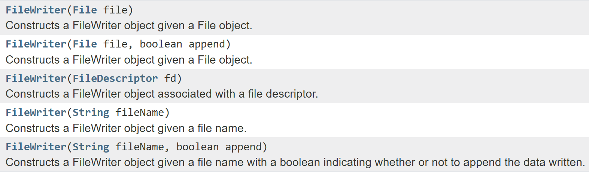
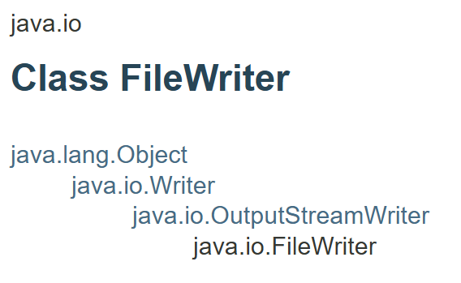
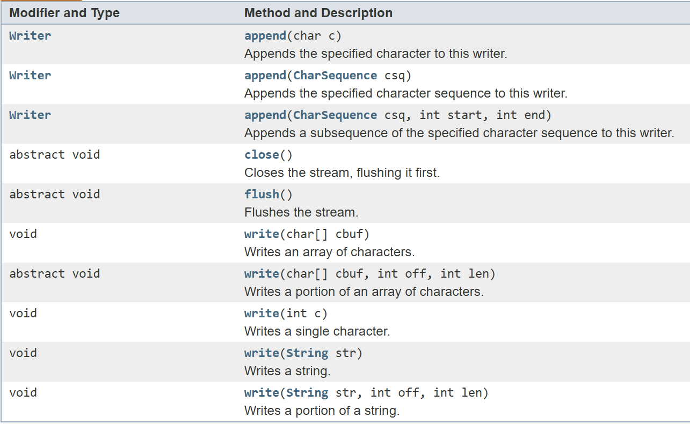

# Writing Text Files

---

# Overview

- Create files and write text with FileWriter
- Explore FileWriter constructors and inheritance
- Recognize methods inherited from Writer
- Understand the role of BufferedWriter

---

# Writing to Files

---

# Creating Files

```java
File myObj = new File("filename.txt");
if (myObj.createNewFile()) {
    System.out.println("File created: " + myObj.getName());
}
```

---

# FileWriter class

```java
FileWriter myWriter = new FileWriter("filename.txt");
myWriter.write("Files in Java might be tricky, but it is fun enough!");
myWriter.close();
```

---

# FileWriter constructors



<!-- footer -->
https://docs.oracle.com/javase/7/docs/api/java/io/FileWriter.html

---

# FileWriter Inheritance Chain



---

# Methods



<!-- footer -->
https://docs.oracle.com/javase/7/docs/api/java/io/Writer.html

---

# BufferedWriter class

- Uses buffering to increase efficiency.

---

# References

- https://docs.oracle.com/javase/tutorial/essential/exceptions/index.html
- https://www.geeksforgeeks.org/array-index-out-of-bounds-exception-in-java/
- https://www.geeksforgeeks.org/checked-vs-unchecked-exceptions-in-java/
- https://www.w3schools.com/java/java_try_catch.asp
- https://www.geeksforgeeks.org/java-io-bufferedreader-class-java/
- https://docs.oracle.com/javase/8/docs/api/java/io/BufferedReader.html
- https://www.geeksforgeeks.org/scanner-class-in-java/
- https://www.w3schools.com/java/java_files_create.asp
- https://www.programiz.com/java-programming/bufferedwriter

---

# Summary

- File provides methods for creating and inspecting files
- FileWriter writes character data to a file
- Constructor options control how a writer opens its destination
- Writer defines shared writing, flushing, and closing operations
- BufferedWriter buffers output; closing writers releases resources
